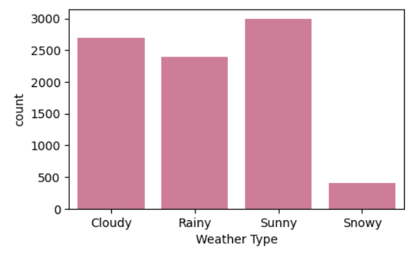
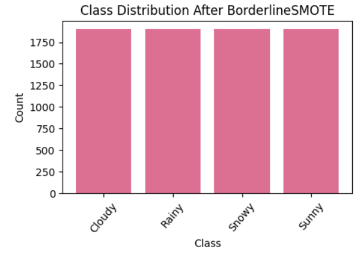
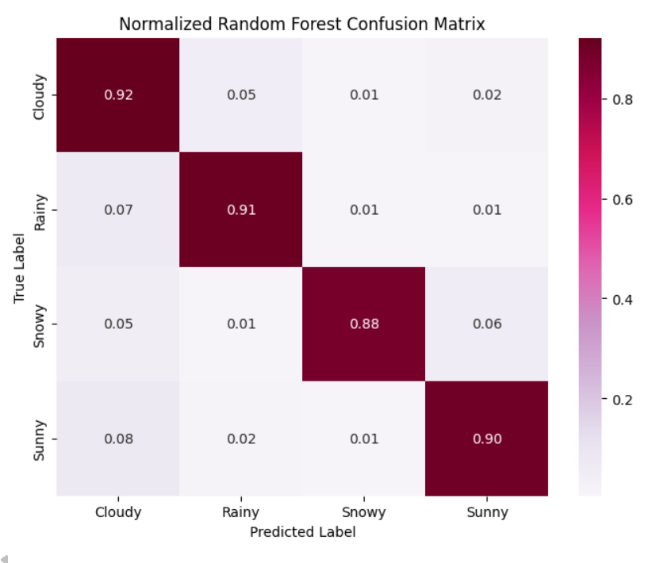
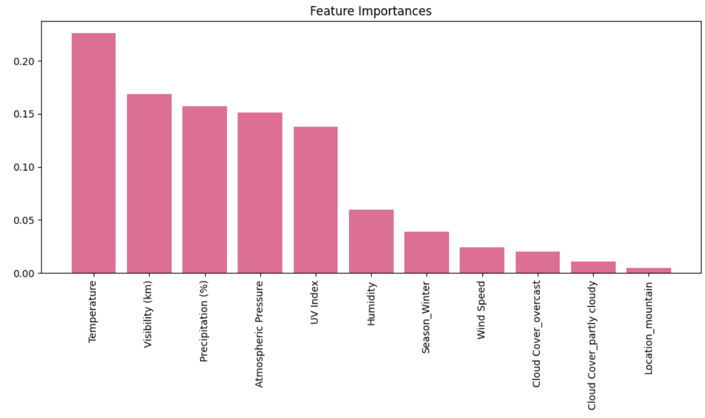

# Weather Type Classification

A learning project that walks through a full classical ML workflow on tabular data: splitting, cleaning, encoding, scaling, class balancing, feature selection, model training and evaluation. The code is written to practice and understand each concept.

**Task:** predict `Weather Type` (Cloudy, Rainy, Snowy, Sunny) from weather measurements.
**Data:** `Weather_classification_data.csv`, 8,500 rows, 7 numeric features (temperature, humidity, wind speed, precipitation, pressure, UV index, visibility) and 3 categorical (cloud cover, season, location).
**Libraries:** pandas, numpy, matplotlib, seaborn, scikit-learn, imbalanced-learn

## Pipeline

```
EDA → train/test split → clean (train only) → encode + scale → BorderlineSMOTE (train only)
    → feature selection → train models → evaluate on test set
```

The split comes first so that everything learned from data (thresholds, scaler ranges, synthetic samples, selected features) comes from the training set only. Using test information anywhere in training is called data leakage.

## Concepts covered

**Class imbalance.** Snowy is about 5% of the data (410 of 8,500), so the classes are checked before modeling.



**Train/test split.** 75/25 with a fixed `random_state`. Adding `stratify` would keep the Snowy share equal in both sets.

**Cleaning (training set only).**
- Duplicates: `drop_duplicates()`, then realign the labels with `Ytrain.loc[Xtrain.index]`.
- Missing values: forward fill (`ffill`). This is really meant for ordered data, and after shuffling it fills from a random row. `SimpleImputer` (median / most frequent) is the better tool.
- Outliers: IQR rule, dropping rows outside `Q1 − 1.5·IQR` to `Q3 + 1.5·IQR` in any numeric column. The test set keeps its outliers, like real unseen data.

**Encoding.**
- One-hot encoding of the categorical features with `pd.get_dummies(drop_first=True)`, which avoids the dummy variable trap. Test columns are aligned to the training columns with `reindex`.
- `LabelEncoder` for the target.

**Scaling.** `MinMaxScaler` scales each feature to [0, 1]. It is fitted on train and only applied to test (`fit_transform` vs `transform`).

**Balancing.** `BorderlineSMOTE` creates synthetic minority samples near the decision boundary. It is applied to the training set only, never the test set. After balancing, the training set has 7,608 rows (the notebook's `Xtrain_resampled` output), split equally across the four classes, as the plot below shows.



**Feature selection.** 15 encoded columns are reduced to 11 in two steps:
- `SelectKBest(f_classif, k=13)`: filter method using the ANOVA F-test.
- `RFE` with Logistic Regression down to 11: wrapper method that repeatedly drops the weakest feature.

**Models.**
- Logistic Regression: linear baseline
- SGDClassifier: linear model trained with stochastic gradient descent (log loss, L1 penalty)
- MLPClassifier: neural network with hidden layers (64, 32)
- Random Forest: bagging of decision trees, with 8-fold stratified cross-validation

**Evaluation.** Accuracy, precision, recall, F1, classification report, confusion matrix (raw and normalized), precision-recall and ROC curves (one-vs-rest for 4 classes), train vs test accuracy for overfitting, and Random Forest feature importance.

## Results

| Model | Test accuracy | Macro-F1 |
|---|---|---|
| SGD | 0.859 | 0.828 |
| Logistic Regression | 0.881 | 0.844 |
| MLP | 0.893 | 0.860 |
| Random Forest | 0.907 | 0.901 |

These are test-set scores from a single split and a single seed. The cross-validation scores printed in the notebook (about 0.97 to 0.99 per fold) are not shown here because of the leakage described below.





## Run

```bash
pip install pandas numpy matplotlib seaborn scikit-learn imbalanced-learn jupyter
jupyter notebook WeatherClassification.ipynb
```

Put `Weather_classification_data.csv` in the same folder.
